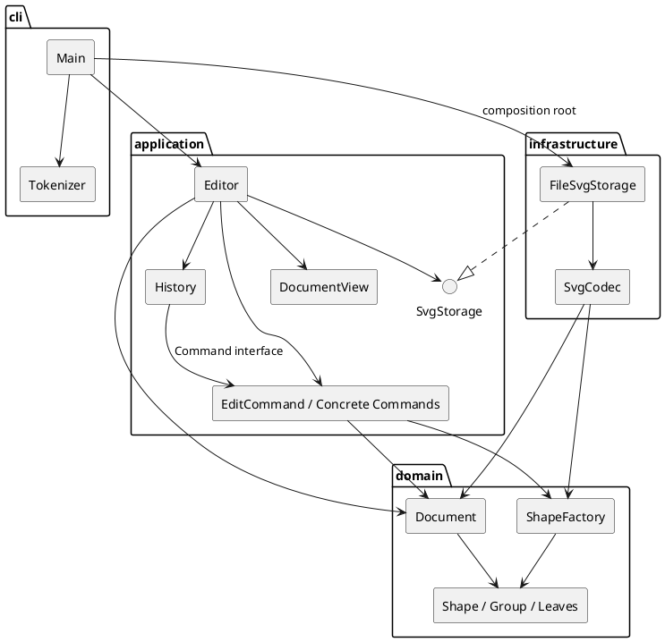

# Lab1 Phase 1：SVG 编辑器（CLI）提交说明

## 1. 仓库与运行

Git 仓库地址：**https://github.com/Kkeith32437/svg-editor-cli**

默认分支：`main`；最终提交标签：`final`。代码、文档、示例及测试均在同一仓库管理。本文件为作业提交文档，根目录 README 为运行入口。

环境：Node.js 24；本地使用 Node.js 24.13.0、npm 11.6.2、Windows PowerShell。

```sh
npm ci
npm run build
npm test
npm run cli
```

`npm run check` 合并编译和测试。交互提示符是 `svg>`，输入 `help` 查看全部命令；Ctrl+C 或输入结束退出。管道回放时省略欢迎语和提示符，便于保存命令结果。

```text
init 400 200
create g flow
create rect start 30 70 120 60 #4a90d9 in flow
create line edge 150 100 250 100 black in flow
create rect end 250 70 120 60 #f5a623 in flow
move flow 10 0
undo
tree
save demo.svg
```

完整两节点示例在 `examples/flowchart.commands`。Windows 回放：

```powershell
Get-Content -Encoding UTF8 examples/flowchart.commands | node --import tsx src/cli/Main.ts
```

输出到 `examples/flowchart.svg`；可直接在浏览器中预览。`examples/import.svg` 用于演示外部文件缺 id 的自动补齐。

## 2. 架构方案

### 2.1 模块划分

| 模块/目录 | 职责 | 主要类型 |
| --- | --- | --- |
| `src/domain/` | 图形状态、几何运算、父子结构、唯一 id 和结构约束 | `Shape`、六个具体图形、`Document`、`ShapeFactory` |
| `src/application/` | 编辑用例、Command 生命周期、历史、文档操作、显示 | `Editor`、`Command`、`EditCommand`、`History`、`DocumentView`、`SvgStorage` |
| `src/application/commands/` | 每个编辑命令的具体行为和参数检查 | 十个具体 Command 类 |
| `src/infrastructure/` | SVG XML 编解码与文件系统适配 | `SvgCodec`、`FileSvgStorage` |
| `src/cli/` | 标准输入/输出、分词、启动时装配依赖 | `Tokenizer`、`Main` |
| `test/` | 行为回归与依赖方向检查 | Node.js test runner |
| `examples/` | 可回放命令、输入文件和生成的 SVG | `flowchart.commands`、SVG 文件 |
| `doc/` | 本提交文档 | `README.md` |

组件图（PlantUML 源码；在支持 PlantUML 的预览器中渲染）：



### 2.2 设计模式与代码落地

**Command（必选）**：`Command` 规定 `execute/undo/redo`；`CreateCommand`、`MoveCommand`、`GroupCommand` 等分别实现编辑行为。`Editor` 负责分发，`History` 调用命令并管理两个栈，不了解几何或树结构细节。一条编辑命令对应一个历史单元，分组多个对象也只入栈一次。命令失败不入栈，也不清空 redo 栈。

**Memento（用于 Command 的状态恢复）**：`EditCommand` 执行前通过 `Document.copy()` 保存深拷贝，成功后保存执行结果；失败则恢复执行前文档。undo 恢复前快照，redo 恢复后快照，避免重做依赖外部可变状态。每条编辑的时间与快照内存开销均为 O(N)，历史共 O(H×N)。本阶段规模较小，先选择容易验证的完整快照；未来文档变大时再换成差量，不引入未用到的持久化历史框架。

**Composite**：`Shape` 提供统一的 `move/scale/set/copy/children` 行为；`Rect/Circle/Ellipse/Line/Text` 为叶子，`Group` 为容器。`Group.move/scale` 递归调用子图形，编辑命令不逐个判断图形种类。几何属性保存在私有 Map 中，读出的属性和子列表是副本，修改走带校验的方法。id 和类型为只读字段，不能通过 `set` 更改。

**Factory**：`ShapeFactory` 是图形类型名到具体类的唯一分派点，并集中定义创建参数；几何行为仍在具体类中实现。新增类型不能通过在编辑命令中不断添加 `switch(tag)` 落地。

**依赖倒置 / Adapter**：应用层定义 `SvgStorage` 接口，`FileSvgStorage` 用文件系统和 `SvgCodec` 实现它；`Main` 装配具体实现。应用层不导入文件系统或 XML 库。

**明确的待重构项**：阶段一保留两处名称分派：`Editor` 的命令注册映射和 `ShapeFactory` 的图形注册映射。二者当前都是内置清单，后续插件阶段应提取为注册接口和 provider，并补充重复注册检查。当前没有宣称已经实现可动态加载的插件系统。

### 2.3 依赖方向规则

| 依赖方 | 允许依赖 | 原因 |
| --- | --- | --- |
| domain | domain | 图形和文档规则独立于输入输出与第三方库 |
| application | application、domain | 用例编排依赖领域行为，以端口表达外部需求 |
| infrastructure | infrastructure、application、domain；XML 和 Node.js 库 | 适配外部格式和文件系统，实现应用层接口 |
| cli | cli、application、infrastructure；Node.js 标准输入输出 | CLI 为装配入口，负责选择具体存储适配器 |
| test | 被测模块和测试库 | 测试不参与运行时依赖反向传播 |

禁止 domain 引用 application/infrastructure/cli；禁止 application 直接引用 infrastructure/cli、文件系统或 XML 库。`cli/Main.ts` 选择 `FileSvgStorage` 是明确允许的装配依赖。

`test/architecture.test.ts` 自动遍历生产代码的静态 imports，验证上述规则；同时检查每文件最多一个导出类、类名与文件名一致以及没有 `switch`。这个检查能约束当前代码，但不等价于证明所有运行时依赖，新增动态导入仍需人工审查。

### 2.4 变化点假设

| 可能变化 | 当前保留的接口/决定 | 取舍 |
| --- | --- | --- |
| 新增图形和 `box` 插件 | Shape 多态、ShapeFactory 集中创建；容器统一语义 | 先不实现插件加载与 `box`，避免超出阶段边界 |
| 从 CLI 扩展到 GUI/agent | Editor 与图形操作不依赖 readline | 新通道可直接调用应用层，不必模拟终端输入 |
| 存储从本地文件改为其他来源 | SvgStorage 端口与 SvgCodec 分离 | 新适配器无需修改领域层 |
| 大文档历史成本 | Command 接口不规定快照形式 | 当前接受完整快照，暂不实现差量或磁盘历史 |
| 新显示格式 | DocumentView 独立于几何与命令 | 可增加 JSON/其他展示器；当前不提前建展示插件系统 |
| 更完整的 SVG 支持 | XML 处理集中在 SvgCodec | transform、CSS、路径等需独立设计和测试；当前显式报错 |

## 3. 功能与语义

实现 `init/read/save/canvas/create/delete/move/scale/set/group/ungroup/addto/front/back/tree/show/help/undo/redo` 全部阶段一命令。

- 六种类型为 `rect/circle/ellipse/line/text/g`，`box` 返回 unknown shape type。
- `create ... in <gid>` 在创建时挂入已有容器；省略时挂根级。fill/stroke 省略则不输出该属性。
- id 全局唯一、大小写敏感。外部 SVG 的缺失 id 按标签加序号补齐并警告；先预留所有显式 id，避免先出现的匿名元素占用后面已有的 id。
- 只有行首（允许前导空白）的 `#` 才表示注释，颜色值中的 `#` 保留。双引号支持带空格/空文本，内部可用 `\"` 与 `\\` 转义。
- `move` 平移位置；`scale` 同乘位置和尺寸，容器递归作用于所有后代，stroke-width 不随之缩放。缩放系数必须为有限正数。
- `set` 只允许作业列出的几何、样式及 text 文本属性，`g` 只允许公共样式。容器样式序列化到 `<g>`，遵循 SVG 样式继承，不主动覆盖子图形显式样式。
- `group` 可跨父容器收编对象，本实现将新组放在根级末尾，并按原文档的先序顺序保存被选节点；拒绝重复选择、祖先与后代同时选择。该定位决策用于消除跨父级分组时的歧义。
- `ungroup` 只接受非根级普通 g，子图形按顺序插到原位置。按照作业错误约定，根级 g 不能解散。
- `addto` 把对象追加到目标容器末尾，拒绝自身及后代循环；`front/back` 仅重排同级节点，SVG 后绘制的节点为前景。
- 删除容器包含整棵子树；撤销恢复原有父级和位置。
- 显示命令及无参 canvas 不入历史栈。成功执行 init/read/save 或修改 canvas 后清空历史并禁止 undo/redo，下一次成功编辑重新启用；失败命令不改变文档、历史或默认路径。
- save 首次需要路径；read 或 save 成功后记录默认路径，后续 save 可省略。文件写入先写同目录临时文件，再重命名替换，写入失败清理临时文件。
- 成功编辑输出摘要；undo/redo 输出 `edit undone` / `edit redone`，tree/show 输出实际属性。错误由 CLI 统一转为 `error:` 前缀的单行，不中断后续输入。

### 外部 SVG 的支持边界

支持六种元素、嵌套 g、白名单属性及纯文本，支持 SVG namespace 和默认单位的数值尺寸。根级仅接受 `xmlns/width/height/viewBox`，viewBox 必须等价于 `0 0 width height`。尺寸省略时默认 800×600；不支持百分比和带单位尺寸。

不支持 transform、CSS、path、tspan、font-size/text-anchor、图像/链接等完整 SVG 特性；读入时显式拒绝不支持的元素或属性，不进行静默丢弃。DTD 与自定义实体也被拒绝。`data-kind="box"` 的 g 可降级读为普通 g，重新保存不保留插件标记。

本阶段是作业要求的基础编辑器，不是任意 SVG 的无损编辑工具。XML 声明/注释、属性排列和空白格式不保证原样保持。超大文件的资源限制、并发编辑、跨进程锁和崩溃恢复尚未实现。

## 4. 过程记录

开发过程主要围绕领域模型、命令历史和 SVG 读写三个部分展开。项目使用 Codex 辅助实现与测试，下面记录方案调整的原因和验证依据。

| 阶段 | 观察/问题 | 处理与证据 |
| --- | --- | --- |
| 需求拆解 | 项目从零开始，需要同时满足功能、面向对象范式和架构文档要求 | 先建立领域模型，再实现命令及读写，最后用测试与目录依赖核对方案 |
| 模型实现 | 若用公开数据袋配合到处判断标签，会违背面向对象要求 | 六种图形各自成类，属性私有封装，Group 递归运算；先提交领域层 |
| 命令实现 | group/delete 的逆操作涉及父级、顺序和整棵子树，逐属性手写逆操作容易漏恢复 | Command 配合完整快照；失败回滚，测试检查整个树是否逐字一致 |
| 首次编译 | XML 库根元素类型推断过窄，子 SVG 元素不能传给序列化辅助逻辑 | 将父节点参数抽象为 Node；TypeScript 编译通过 |
| 首轮测试 | 需要验证颜色 # 不被当作注释、匿名 id 不占用后续显式 id、失败后 redo 是否保留 | 增加分词、预留 id、历史与失败原子性回归测试；首轮 14 项通过 |
| 架构自查 | 初版 SVG 读入直接判断 text 类型名，形成工厂外的额外类型分派 | 改为 Shape.content 能力，由 Text 多态覆盖；将类型行为放回图形对象 |
| 外部 SVG 审查 | 任意 viewBox 或根样式若被忽略，会改变实际图像 | 增加根属性和 viewBox 验证，对未支持的渲染语义报错；说明兼容边界 |
| 补充验证 | 仅通过功能示例不足以约束依赖方向和白名单 | 新增静态 import 规则检查、所有类型属性测试和 SVG 边界测试，共 17 项通过 |
| 示例回放 | 需要验证分组、中文文字、undo 与文件输出能连起来使用 | 回放 flowchart.commands，生成 8 个元素的 flowchart.svg，保留示例文件 |

开发阶段对应 Git 提交：

1. `feat: add encapsulated SVG domain model and composite groups`
2. `feat: implement transactional commands history REPL and SVG storage`
3. `test: cover CLI behavior atomic edits history and SVG round trips`
4. `fix: enforce layer boundaries and reject unsupported SVG rendering semantics`
5. 文档、示例及 CI 配置随后单独提交。

上述提交分别保留领域模型、命令与读写、行为测试、架构修订和文档示例的阶段结果。提交时间较集中，反映本次集中开发的实际情况；功能是否可靠还需要结合代码差异、测试结果和示例回放判断。

## 5. 一致性自查

### 5.1 实际目录与方案

实际目录与 2.1 的四个生产模块及支持目录一致。每个生产类独立文件且文件名等于类名；Command/SvgStorage 为接口文件。命令按行为分别成类；Main 仅负责输入输出和依赖装配。

修订记录：SVG 读入中的 text 名称判断已移除，改为对象能力；快照保存策略明确落在 EditCommand 内，不新增只装数据的全局快照管理器。以上修订已经同步到当前方案与代码。

### 5.2 依赖方向

抽样：`MoveCommand -> EditCommand/Document/Shape`；`History -> Command`；`Editor -> SvgStorage`；`FileSvgStorage -> SvgStorage/SvgCodec`；`Main -> Editor/FileSvgStorage/Tokenizer`。不存在 application 导入具体文件适配器的依赖。

自动检查遍历全部生产 TypeScript 文件的静态 import，目前通过。domain 无外部依赖；application 不引用 Node 文件系统与 XML 库。保留的 Editor 命令映射和 ShapeFactory 图形映射已明确列为后续重构项。

## 6. 质量保证手段

### 6.1 实际执行结果

本地完成 `npm run check`：**TypeScript 严格编译通过，17 项测试全部通过，0 失败**。测试使用 Node.js 自带 test runner，经 tsx 执行。

| 验证范围 | 主要依据 |
| --- | --- |
| 模块与面向对象约束 | 依赖方向、单文件类数量、类名文件名匹配检查 |
| 分词 | 中文、带空格/空文本、引号转义、Windows 路径、颜色与注释 |
| 完整命令入口 | help 列出所有命令；未初始化错误；六种类型创建 |
| 图形运算 | 嵌套组整体平移/缩放、线段双端点、所有类型几何属性与样式白名单 |
| 结构编辑 | 跨父级分组顺序、祖孙循环拒绝、解组位置、删除整树恢复、同级 z-order |
| 历史 | 一命令一单元、多步 undo/redo、成功新编辑清空 redo、失败编辑保留 redo |
| 原子性 | 参数、缺失 id、重复 id、错误容器、浮点溢出导致的中途失败后整树恢复 |
| 文档操作 | 保存和读取、默认路径、canvas 读写、成功 IO 屏障、失败 IO 保留状态和历史 |
| SVG 数据 | 六种类型及中文/特殊字符往返、唯一 id 预留、无效 XML/不支持特性拒绝 |
| 真实 CLI | 子进程接受脚本，错误输出后继续执行，管道模式无提示符干扰 |

另已实际回放 `examples/flowchart.commands`，验证生成的 XML 有 8 个图形元素。测试覆盖的是选取的代表场景，不宣称穷尽所有输入或百分之百覆盖率。

### 6.2 持续验证与局限

`.github/workflows/ci.yml` 配置 Windows/Ubuntu、Node.js 24 的构建和测试，远程 CI 已通过。新增代码和修复应保持 `npm run check` 通过。

当前测试主要覆盖功能正确性与架构约束，大型文档性能、并发写入及复杂文件系统异常尚未充分验证，后续可进一步补充。
